# vhs

Write terminal recordings from OCaml, and record cram tests as animated SVG
images or GIFs.

[VHS](https://github.com/charmbracelet/vhs), by [Charm](https://charm.land/),
records a terminal session as an animated GIF (or a video) from a script. The
script, a `.tape` file, lists what to type and what to wait for, one command
per line. Tapes are easy to write by hand, but VHS only finds their mistakes
while recording, and when the program changes, the GIF can go on showing what
it used to do.

This library builds tapes as OCaml values and checks them before VHS runs, so
a demo can be generated by the same code that tests the program, and a change
to the demo shows up in a diff. It also turns a cram test (a file of shell
commands with the output each one must print, which dune checks) into a
recording of that test. The library records a tape itself as an animated SVG
image, which needs no other program; a GIF or a video still needs `vhs`.



The recording above is [doc/demo.t](doc/demo.t), recorded natively with
`dune exec -- vhs-cram --output doc/demo.svg doc/demo.t`.

## Installation

```
opam install vhs
```

Until vhs is in the opam repository, install it from GitHub:

```
opam pin add https://github.com/samoht/ocaml-vhs.git
```

To make GIFs, you also need [VHS](https://github.com/charmbracelet/vhs#installation)
itself.

## Usage

A tape is a list of settings, the files to write, and a list of actions:

```ocaml
let tape =
  Vhs.tape
    ~settings:[ Font_size 18; Width 1000; Height 560 ]
    ~outputs:[ "demo.gif" ]
    [ Vhs.type' "dune test\n"; Vhs.wait Prompt; Vhs.sleep (Ms 2000) ]
```

`Vhs.type'` types text, a newline pressing Enter. `Vhs.wait Prompt` waits for
the shell prompt to come back, so the recording shows the whole output of the
command however long it takes; the final sleep keeps it on screen. `Vhs.pp`
prints the tape in the format VHS reads:

```ocaml
# Fmt.pr "%a" Vhs.pp (Result.get_ok tape);;
Output "demo.gif"
Set FontSize 18
Set Width 1000
Set Height 560
Type "dune test"
Enter
Wait
Sleep 2000ms
- : unit = ()
```

`Vhs.tape` returns an error for a tape VHS would reject or partly ignore, and
names the offending line:

```ocaml
# Vhs.tape ~outputs:[ "demo" ] [ Vhs.sleep (Ms 100) ];;
- : (Vhs.t, Vhs.error) result =
Error
 (Vhs.Invalid "Output \"demo\": neither an extension nor a trailing slash")
```

`Vhs.Prompt` relies on the prompt VHS gives each shell it starts, which ends
with `>`, so it also holds while a command prints a line ending with `>`. A
tape that changes the prompt, or runs such a command, should wait for
something else, with a regular expression on the line under the cursor
(`Vhs.Line`) or on the screen (`Vhs.Screen`).

`Vhs.render` runs `vhs` on the tape in a given directory, and returns an error
when `vhs` is not installed or fails:

```ocaml
let make_gif env tape =
  let clock = Eio.Stdenv.mono_clock env and cwd = Eio.Stdenv.cwd env in
  match Vhs.render ~clock ~proc:(Eio.Stdenv.process_mgr env) ~cwd tape with
  | Ok () -> ()
  | Error e -> Fmt.epr "%a@." Vhs.pp_error e
```

## Recording without VHS

`Vhs.record` plays the tape in bash, zsh or fish on a pseudo-terminal, reads
what the shell prints with a terminal emulator that follows xterm, and
writes the screens to each `.svg` output of the tape as an
animated SVG image, and its text to a `.txt`, `.ascii` or `.test` output as
VHS writes it. The image holds text, no script and no external resource,
and animates with CSS alone, so it plays in an HTML `` and in a README
on GitHub. VHS cannot write `.svg`, so an `.svg` output is not in the tape
that `vhs` reads:

```ocaml
# Vhs.tape ~outputs:[ "demo.svg" ] [ Vhs.type' "ls\n" ] |> Result.map Vhs.to_string;;
- : (string, Vhs.error) result = Ok "Type \"ls\"\nEnter\n"
```

```ocaml
let make_svg env tape =
  let clock = Eio.Stdenv.mono_clock env and cwd = Eio.Stdenv.cwd env in
  match Vhs.record ~clock ~proc:(Eio.Stdenv.process_mgr env) ~cwd tape with
  | Ok _svg -> ()
  | Error e -> Fmt.epr "%a@." Vhs.pp_error e
```

The terminal has the size VHS gives it, and the image uses the colours of the
tape's theme, named or in JSON, and VHS's window bar and margin. Wait patterns
match as Go's do. Time follows the tape: typing and sleeping take the time the
tape says, whatever the machine does around them, so the same output gives the
same image. A `Screenshot` writes a still SVG image, and `Source` plays the
lines of another tape. A few things need VHS, such as the other shells or
a colour name in a JSON theme; `Vhs.record` names them in its error.
`Vhs.svg` draws the image of output given with its times, without running
anything.

## Recording a cram test

A cram test is a `.t` file, in the format of Mercurial's test runner that
Brodie Rao's [cram](https://bitheap.org/cram/) popularised and dune runs: each
line starting with `  $ ` is a shell command, and the lines below it are the
output it must print. The `vhs-cram` command types each command into a bash
terminal and waits for the prompt to come back before the next one, so the
recording shows each command with its output. `--print` shows the tape
instead of running `vhs`:

```sh
$ printf '  $ echo hello\n  hello\n' > hello.t
$ vhs-cram --print --output hello.gif hello.t
Output "hello.gif"
Set Shell "bash"
Hide
Env VHS_CRAM_PROMPT `bind 'set input-meta on'; bind 'set output-meta on'; bind 'set convert-meta off'; __vhs_n=; __vhs_prompt() { PS1='\[\e[38;2;90;86;224m\]> \[\342\200\213\342\200\213\342\200\213\342\201\240\342\201\240\342\200\213\342\200\213\342\200\213\342\201\240\342\200\213\342\201\240\342\201\240\342\200\213\342\200\213\342\201\240\342\201\240\e[0m\]'; __vhs_n=$__vhs_n'\342\200\213'; PS2='> \[\342\200\213\342\200\213\342\200\213\342\201\240\342\201\240\342\200\213\342\200\213\342\200\213\342\201\240\342\200\213\342\201\240\342\201\240\342\200\213\342\200\213\342\201\240\342\201\240'$__vhs_n'\]'; }; __vhs=$(printf '%s\n' ${PROMPT_COMMAND+"${PROMPT_COMMAND[@]}"} __vhs_prompt); unset PROMPT_COMMAND; PROMPT_COMMAND=$__vhs; unset __vhs VHS_CRAM_PROMPT`
Type 'eval "$VHS_CRAM_PROMPT"; clear'
Enter
Wait+Line /\x{200B}\x{200B}\x{200B}\x{2060}\x{2060}\x{200B}\x{200B}\x{200B}\x{2060}\x{200B}\x{2060}\x{2060}\x{200B}\x{200B}\x{2060}\x{2060}$/
Show
Type "echo hello"
Enter
Wait+Line /\x{200B}\x{200B}\x{200B}\x{2060}\x{2060}\x{200B}\x{200B}\x{200B}\x{2060}\x{200B}\x{2060}\x{2060}\x{200B}\x{200B}\x{2060}\x{2060}$/
Sleep 1000ms
```

An output ending in `.svg` is recorded by `vhs-cram` itself, with
`Vhs.record`, and the others by `vhs`:

```
$ vhs-cram --output hello.svg hello.t
```

A setup script, given with `--setup`, runs before the first command without
being recorded. `vhs-cram` then makes the last command of bash's
`PROMPT_COMMAND`, after any prompt hook the setup installs, set the prompt to
the one VHS gives bash followed by an invisible mark, sixteen zero-width
characters that spell a digest of the cram test, and waits for that mark:
output that ends with `>`, or with a zero-width space, while its command still
runs is not mistaken for the prompt. A command that leaves bash waiting for more input,
such as an unterminated quote or here-document, makes that wait time out, and
`vhs-cram` then names the command.

## Credits

The tapes are for [VHS](https://github.com/charmbracelet/vhs) by
[Charm](https://charm.land/) (MIT), whose themes the SVG images use and
whose parser defines the syntax, key names and checks that this library
follows. The `.t` format comes from Mercurial's test runner, made popular by
Brodie Rao's cram, and is the one dune runs. The native recorder runs on the
pseudo-terminals and the terminal emulator of Thibaut Mattio's
[matrix](https://github.com/tmattio/mosaic) (ISC).

## License

ISC. See [LICENSE.md](LICENSE.md).
